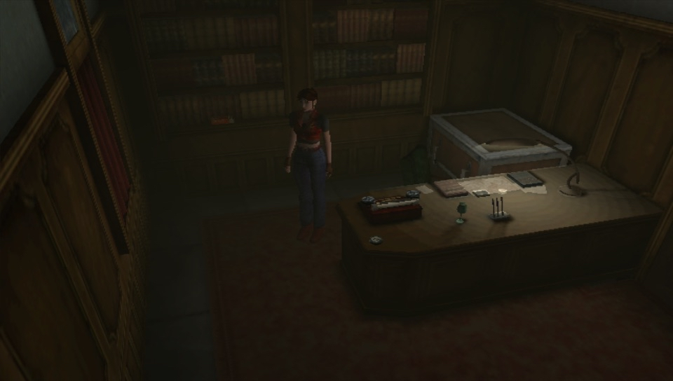

# Resident Evil: Code Veronica X Vita

</img> 

Port of Resident Evil: Code Veronica X for PSVita based off [the decompilation](https://github.com/AshfordFamily/recvx-decomp) of the PS2 version.

## Features

- 960x544 internal resolution.
- Support for MSAA (up to 4x, defaults to 4x).
- Modern controls option.
- First Person mode (with dual analogs controls if Modern Controls enabled).
- Built-in cheats menu.
- Widescreen support (Defaults to On).
- Ability to disable Motion Blur (Disabled by default).
- Support for French, Spanish and German languages.
- Doors/Stairs animations skip (Press X to skip them).

## Special Controls

- Additional options menu accessible by touching the top-left portion of the screen.

## How to Install

- Install `libshacccg.suprx`, if you don't have it already, by following [this guide](https://samilops2.gitbook.io/vita-troubleshooting-guide/shader-compiler/extract-libshacccg.suprx).
- Install the vpk from the Release tab.
- Extract the `setup.zip` from the Release tab in a folder in your PC.
- Place the iso file of `Resident Evil: Code Veronica X NTSC-U` for PS2 named as `recvx.iso` in the same folder where you extracted the zip.
- If you don't have it already, install [Python 3.10 or higher](https://www.python.org/downloads/windows/).
- Open a command line in the same folder where you extracted the zip and run: `python pc-tools/prepare_assets.py "recvx.iso" "recvx" --ffmpeg "ffmpeg.exe"`
- Place `recvx.iso`, `native-assets.psarc` and `movies.psarc` in `ux0:data/recvx`.
- Extract the `data.zip` from the Release Tab in `ux0:data/recvx`.

## Credits

- The team that worked hard for years on the [decompilation of the game](https://github.com/AshfordFamily/recvx-decomp)
- shoui for the [original core adaptation to make the decompilation boot on PSVita](https://github.com/shoui520/recvx-vita)
- Matichu for testing the game from start to finish with multiple runs to ensure everything works as expected.
- Standard-Republic for the Livearea assets.
