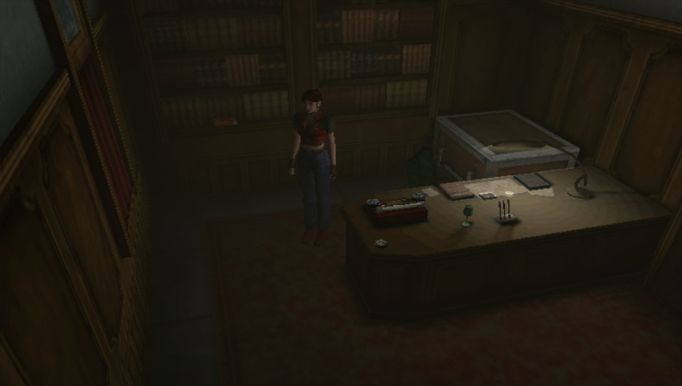

# Resident Evil: Code Veronica X Vita

</img> 

Port of Resident Evil: Code Veronica X for PSVita based off [the decompilation](https://github.com/AshfordFamily/recvx-decomp) of the PS2 version.

## Features

- 960x544 internal resolution.
- Support for MSAA (up to 4x, defaults to 4x).
- Modern controls option.
- First Person and Third Person (Over the shoulder) mode (with dual analogs controls if Modern Controls enabled).
- Built-in cheats menu.
- Widescreen support (Defaults to On).
- Considerably faster loading times.
- Ability to reload weapon without accessing the Inventory menu by pressing Square while aiming.
- Difficulty selection (Very Easy, Easy, Normal).
- Ability to disable Motion Blur (Disabled by default).
- Customizable fog density.
- Support for French, Spanish, Italian and German languages.
- Doors/Stairs animations skip (Press X to skip them).
- Support for BioRand randomizer (tested with v.3.3.2).

## Special Controls

- Additional options menu accessible by touching the top-left portion of the screen.
- Flicking the right analog will trigger a 180 turn when playing in fixed camera tank controls mode.

## How to Install

- Install `libshacccg.suprx`, if you don't have it already, by following [this guide](https://samilops2.gitbook.io/vita-troubleshooting-guide/shader-compiler/extract-libshacccg.suprx).
- Install the vpk from the Release tab.
- Extract the `setup.zip` from the Release tab in a folder in your PC.
- Place the iso file of `Resident Evil: Code Veronica X NTSC-U` for PS2 named as `recvx.iso` in the same folder where you extracted the zip.
- If you don't have it already, install [Python 3.10 or higher](https://www.python.org/downloads/windows/).
- Open a command line in the same folder where you extracted the zip and run: `python pc-tools/prepare_assets.py "recvx.iso" "recvx" --ffmpeg "ffmpeg.exe"`
- Place `recvx.iso`, `native-assets.psarc` and `movies.psarc` in `ux0:data/recvx`.
- Extract the `data.zip` from the Release Tab in `ux0:data/recvx`.

## How to use BioRand

- Download [BioRand](https://github.com/biorand/classic/releases)
- Generate a new randomizer with it using your iso file as source.
- Place `recvx_biorand.iso` and `mod_biorand/log_pl0.txt` in the same folder where you extracted `setup.zip`.
- Open a command line in the same folder where you extracted the zip and run: `pc-tools\prepare_biorand.bat "recvx.iso" "recvx_biorand.iso" "log_pl0.txt" "recvx/native-assets.psarc" "recvx-biorand"`
- Copy `recvx-biorand/biorand.psarc` in `ux0:data/recvx` and enable BIORAND option in game.

## Changelog

### v.1.2

- Updated to latest vitaGL commit.
- Further optimized the whole game, reducing CPU workload by up to 12%.
- Fixed a bug causing misaligned text in the Memory Card selection when using languages different from English.
- Added Italian localization support.
- Added a new option to change fog density across the whole game.
- Improved widescreen geometry clipping: now improperly clipped geometry will be a lot more rare when playing in widescreen.
- Fixed a bug causing the monitor when Steve gets trapped in the lugers room to show a garbled image.
- Fixed Z-Fighting issues on several models. (Example: the prison map at the start of the game)
- Precompiled all possible shaders theoretically usable by the game and bundled them in the vpk: this will solve any shader miss stutter.
- Improved Camera Sensitivity option: now can be fine tuned more precisely.
- Fixed a bug causing stray lines to appear in the Inventory screen.
- Added a new option to skip intros at the boot of the game. With this on, the game will jump directly in the Main Menu.
- Fixed a bug causing inputs lock if the rearpad was pressed after closing the Options menu.
- Fixed a bug causing movements lock when stopping aiming under certain circumstances.
- Improved localization system: now it covers also UI elements and image-based texts.
- Added Difficulty selection (Very Easy, Easy, Normal) when you start a New Game.
- Fixed a bug causing potential loss of the lighter/lockpick when using the item box under certain circumstances.
- Made so that pressing Square while aiming allows for reloading weapons. (RE4 style)
- Greatly reduced loading times overall.

### v.1.1

- Added support for BioRand randomizer.
- Added Third Person (Over the shoulder) mode option.
- Fixed a bug making pushing objects while using modern controls to be near impossible.
- Improved direction movement handling during camera changes when using modern controls.
- Added a new cheat TAPELESS SAVE that allows to save without tapes requirements.
- Fixed a bug causing some stairs animation to render only the upper part of the animation.

## Credits

- The team that worked hard for years on the [decompilation of the game](https://github.com/AshfordFamily/recvx-decomp)
- shoui for the [original core adaptation to make the decompilation boot on PSVita](https://github.com/shoui520/recvx-vita)
- Matichu for testing the game from start to finish with multiple runs to ensure everything works as expected.
- Standard-Republic for the Livearea assets.
- fmil95 for providing some useful bugfixes snippets.
- ProjectZero92 for the Italian localizaion patch integrated in the port.
